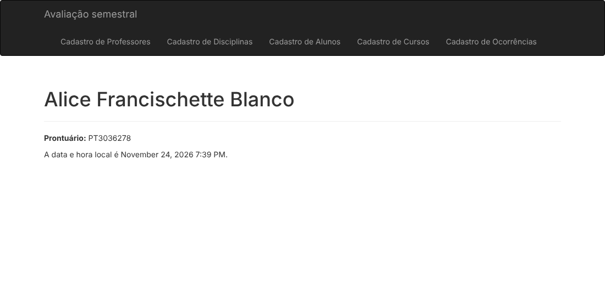

# Avaliação Final – 24/11/2026

Aplicação web em **Flask** hospedada no **PythonAnywhere**.
Rota implementada: **Cadastro de Professores** (`/professores`).

## Rotas
| Rota | Descrição |
|------|-----------|
| `/` | Nome e prontuário da aluna, com a data e hora local |
| `/professores` | Cadastro de Professores (formulário + relação de professores cadastrados) |
| qualquer outra (`/disciplinas`, `/alunos`, `/cursos`, `/ocorrencias`) | Não possuem rota: o tratamento de erro 404 mostra **"Não disponível"** |

## Recursos utilizados
- Rotas e blueprint (`app/main/views.py`)
- Tratamento de erros 404 e 500 (`app/main/errors.py`)
- Templates e herança (`base.html` → `index.html`, `professores.html`, `404.html`, `500.html`)
- Flask-Bootstrap
- Flask-Moment (data e hora local no navegador)
- Formulários com Flask-WTF (`app/main/forms.py`)
- Banco de dados SQLite com Flask-SQLAlchemy e Flask-Migrate (`Professor` e `Disciplina`)

## Tela inicial


## Executar
```bash
python3 -m venv venv
source venv/bin/activate
pip install -r requirements.txt
export FLASK_APP=flasky.py
flask db upgrade
flask run
```
Testes: `flask test`
